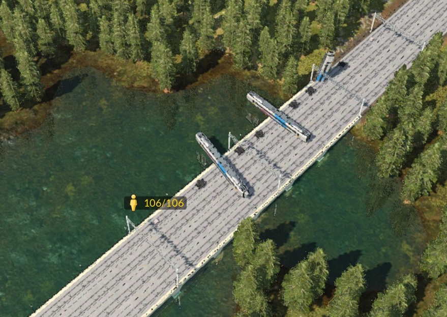

# TF3 Mod Toolbox

*A Windows toolbox for dragging Transport Fever 2 mods, kicking and screaming, into Transport Fever 3. Yes, the train
bodies used to spin. They don't any more, but it was really funny to watch after several hours of debugging. (Running in the 90's anyone?)*

This is the staging repo for the TF3 Mod Toolbox (circa November 2026, which in Transport Fever 3 years is roughly
"launch week plus a lot of coffee").

The Toolbox is a C# / .NET 10 WinForms application with one shared core and a converter, a fixer and a growing pile of
editors for each kind of thing Transport Fever moves or parks:

- **Converters**: TF2 mod (folder or zip) in, TF3 mod out. Trains, trams, buses and trucks, aircraft and modular
  stations, each with its own converter, because a 747 is not a tram no matter how you squint.
- **Fix & Validate**: every problem found while testing a conversion in the game becomes a detector *and* an automatic
  fix, so mods converted before the fix existed can be repaired too.
- **Editors**: mod info, vehicle details and formations, tuning, and for stations a builder, a configurator and an
  object editor for walking paths, with 2D and 3D views.

No Norse name this time. The Valkyrie is in the author's handle, and the naming committee (me) has ruled that it
counts. Inside the code it's still called the *Toolkit*, because naming things is one of the two hard problems, and I'd
already used up my patience on the other one (cache invalidation, see "Station Configurator").

## What started it

Transport Fever 2 has years of brilliant workshop mods. TF3 can load a surprising amount of them after conversion, and
then quietly does things like:

- dropping every driving car of a train because a headlight mesh from TF2's base game wasn't copied;
- showing an empty depot because the TF2 models have no driver (`drivingLicense = "NONE"`), so TF3 skips them all;
- spinning car bodies in random directions while the bogies sit perfectly on the track (bogie groups at the car origin);
- making cars vanish at certain camera angles, because their culling box is exactly their outline;
- keeping the doors shut, and silent, when it asks a train to open all its doors;
- having passengers stand *inside* a converted platform, then teleport to the exit in a huff.

The converter started life as a C# port of GermanChickenT's Python *GCT TPF3 Konverter*. It keeps that tool's good
ideas, and its readme invites people to copy and improve it, so I did and then got a little ambtious. The rest of the Toolbox grew around one rule:
**if it broke in the game, the Toolbox learns to detect it and fix it hopefully, or scream loudly at you to not continue, for you to ignore it and install anyway..**

What's in the box:

- **Conversion pipeline**: TF2 Lua data is read in a sandbox (MoonSharp: no io, no os, an instruction budget, so an
  endless loop in someone's 2019 station script stops politely). TF3 files are parsed as plain data, never run.
  Meshes, textures (including BC5 normal maps with the header TF3 can't read), animations, mod info and buy-menu groups
  are rewritten for TF3.

- **Custom sounds**: a TF2 sound set isn't swapped for a base-game one. Each track runs the *original* TF2 update
  function through a compatibility shim, on TF3's live values, so the inverter whine whines the way its author meant.

- **Stations**: TF2 station code is kept and runs in TF3 through a small adapter (it maps the names, renumbers terminals and
  moves the result into a TF3 subconstruction). The Toolbox runs TF3's *own* construction scripts in its own runner to
  show you what the game would build. The adapter's lessons are measured, never guessed; ask me about the 1.1 m vs
  1.5 m platform incident sometime. Bring snacks, and maybe caffeine - 8 hours that I'll never get back...

- **Safety**: every fix backs up the mod's text files first, and nothing is written into the game's mods folder unless
  you press Install (or confirm that you really meant the game's copy).

## Elephant in the room - Where is the code?

Pending a licensing check and a clean up of the comments and documentation, an early preview is ready but needs some commercial packages removing first.

Those modules are part of the "Next" version's UI - Still WinForms in dotnet 10 for now. 

There is an open question around work to prevent people converting a mod and passing it off as their own and uploading, this is currently discouraged by an enforced stamp into the mods description and a nuisance dialog reminding people to stay honest, the thoughts on how to try and resist this so far would all be easily circumvented by AI tools or changing the source. 

If you have a suggestion on how to handle this please open a PR or Discussion!

- So far, a closed source module that handles the export/install and "signs" and records data about the mods involved, with a blocklist for mod authors to request blocking is the idea on where to go with this.

## Screenshots and videos

The mods in these belong to their authors, credited in [Credits.md](Credits.md).

**Station Configurator** with Oppie's NL Modular Stations on TF3's own modular station: platforms, overpasses and the
module palette (blue markers are free slots, orange ones are taken).

The same station with **Paths** on: every walking path the game would build, drawn over the models.

**Object Editor**: the walking paths of NL's passenger overpass, from above and in 3D. These were taken while the paths
of TF2-code modules were still view only; they can be edited now.

**Train editor** with Scotchbob & Mezzie's Desiro Class 350 & 450: the 3D preview's vehicle gallery, the multiple-unit
formation visualizer, and Fix & Validate finding 385 things to grumble about (30 of them fixable with one click).

Videos, on YouTube in the [TF3 Mod Toolbox playlist](https://www.youtube.com/playlist?list=PLLGjMp72mnmM):

<table>
  <tr>
    <td align="center" width="33%">
       
      <b>Mod conversions, then in the game</b>
    </td>
    <td align="center" width="33%">
       
      <b>3D viewer demos</b>
    </td>
    <td align="center" width="33%">
       
      <b>Multiple-unit / tram formation editor and details screens</b>
    </td>
  </tr>
</table>

## Planned features

The roadmap is honest about being a roadmap:

- **Brand-new mods, not just conversions.** The station path and model tools are being built so the same windows can
  make a station from scratch.
- **One station designer** instead of a Station Builder *and* a Station Configurator (they're being merged and
  simplified).
- **Nudging models in the configurator** through "Fix / correct in Object Editor", rather than special rules per mod.
- **A build-menu tab per converted station mod**, and proper building categories.
- **More station families**: street, harbour and airport.
- **Cargo**: loads that show on converted trucks and wagons, and editing which cargo a vehicle takes.
- **Ships**, so the shared vehicle library finally has a reason for its water classes.
- **Shared vehicle editors** for trains, road, trams and aircraft on one library, plus a tram formation visualizer.
- **Aircraft**: the Fleet/Livery view, airport size set in the editors, and the TF2 base-game planes TF3 doesn't have.
- **Gangway bellows that bend on curves.** Converted ones are rigid and open up in curves; TF3's are skinned meshes bent
  by fake bogies.
- **The new interface** (codename Next), and release builds once the licensing for its components is sorted.

## Architecture in one breath

TF2 mod folder or zip → sandboxed Lua loader reads the TF2 data → a converter per family (rail, tram, road, air,
stations) writes TF3 models, meshes, textures, sounds (via FFmpeg) and mod info → detectors and fixes run over the
result → a backup before anything changes → Sync installs into the game's mods folder only when you press Install → the
log analyser reads TF3's `stdout.txt` and points each error at the fix that resolves it. Station mods keep their TF2
code behind the adapter, and the Toolbox runs that code and TF3's own station scripts (Teal included) in its own
runner, so the Builder and Configurator show what the game would build before you start the game.

Why it's shaped like this: once the train conversion worked in the game, its code was frozen, and every other family got
its own converter and editors instead of one converter that knows everything and breaks everything. It also runs in
**low-impact mode** by default (below-normal priority, one background job at a time, lazy indexing), because the person
writing it is usually playing Transport Fever 3 at the same time, and TF3 wants all the CPU it can get.

Speaking of things you shouldn't do with it:

- Converted mods remain the work of their original authors. Keep them for private use, and share them only with the
  author's permission.
- TF3 doesn't allow selling mods, and neither do I.
- Copying TF2 base-game files into a conversion (headlight meshes and the like) is only acceptable for private use.

DO NOT USE This for anything important - yet:

THE SOFTWARE IS PROVIDED "AS IS", WITHOUT WARRANTY OF ANY KIND, EXPRESS OR
IMPLIED, INCLUDING BUT NOT LIMITED TO THE WARRANTIES OF MERCHANTABILITY,
FITNESS FOR A PARTICULAR PURPOSE AND NONINFRINGEMENT. IN NO EVENT SHALL THE
AUTHORS OR COPYRIGHT HOLDERS BE LIABLE FOR ANY CLAIM, DAMAGES OR OTHER
LIABILITY, WHETHER IN AN ACTION OF CONTRACT, TORT OR OTHERWISE, ARISING FROM,
OUT OF OR IN CONNECTION WITH THE SOFTWARE OR THE USE OR OTHER DEALINGS IN THE
SOFTWARE.

(That includes your save game. Back it up. The Toolbox backs up the mods; your 400-hour city is your business.)

## Standing on shoulders

- GermanChickenT's *GCT TPF3 Konverter*, where the converter began.
- The open source libraries and tools in [Credits.md](Credits.md), with their licences: MoonSharp, ImageSharp, Pfim,
  OpenTK, Teal and FFmpeg among them.
- Urban Games' own scripts in the game's `base/content`: the best documentation TF3 has, provided you're willing to dig
  through about 55 GB of zip files to find the right paragraph. Nearly every fix in here was checked against them.
- The mod authors whose work got converted, prodded and occasionally spun: Oppie (NL Modular Stations), Scotchbob &
  Mezzie (Desiro Class 350 & 450), Jotrain Gamer (Gold Coast G:link), Lexygone (Boeing 747) and cw_315 (CAF Mark 5a
  coaches, the original spinners), plus a TF3-native Japanese rural station mod that already knew how to lift
  passengers onto a high platform.
- And all the modding community for their endless contributions to both Transport Fever 2 and Transport Fever 3.

## Status

Alpha, developed against the real game by a infra admin who meant to *play* Transport Fever 3 and is now,
somehow, writing a station walking-path editor. Not accepting "please convert my mod for me" requests; enthusiastically
accepting bug reports, especially ones with the relevant lines of `stdout.txt` attached.

The interpretive dance that started all this is at the bottom, in the origin story.

The code lands in `src/` when it's relatively battle-tested (see below). You'll need Windows, the .NET 10 runtime,
Transport Fever 2 and 3 installed, and FFmpeg if you want the sounds converted.

## AI/LLM Disclosures

Yes, AI was used, and exactly what for is in [AI-Disclosures.md](AI-Disclosures.md). The short version: Claude Code
helped research the libraries behind the station builder and the 3D views, decipher mod-script fields and the game's
API, write documentation and troubleshoot the station tools. The GUI and its messages are all my own work for better or worse...

The rule is the same as everywhere else I work: Trust But Verify. Nothing in the ✅ column got there without being tried
in TF3, or, for the Toolbox's own windows, used day to day.

## Licensing

New territory for the author. Once the code is uploaded, every effort will be made to follow the licences of the open
source projects it uses, and of the original converter it grew from. If you do spot an error, please let me know by
raising an issue.

## Code-History/Origin

Work is carried out on a locally hosted git repo, without public access, and is pushed here when relatively
battle-tested.

## Does it actually work?

Mostly, yes! The trains go forwards now, which is more than they did on day one.

As of 12th November 2026 -

Converted UK trains (the Mark 5a coaches, Class 390 and Class 700/707 were the test victims) run in TF3 with their bodies
pointing the right way, their headlights present and their buy-menu groups intact. Jotrain Gamer's Gold Coast G:link,
converted as a tram, runs as a tram and as light rail on tram tracks. Lexygone's Boeing 747 flies. Oppie's NL Modular
Stations converts, loads, and its platforms, stairs, footbridges and underpasses work on TF3's own station with
passengers actually using them.

Legend: ✅ works and has been tested (in TF3 where it matters) · 🧪 built, waiting for its test · ⚠️ works, with a known
quirk · 🔨 being written, or on the roadmap

| Thing | State |
|---|---|
| TF2 → TF3 trains: locomotives, wagons, multiple units | ✅ shipped (to my own mods folder) |
| Fix & Validate for trains: bogie pivots, missing TF2 meshes, drivers, icons, door animations, culling boxes, gangways, comfort, BC5 headers, label fonts, availability… | ✅ each one exists because it broke first |
| Workshop library (tiles, UK filter, conversion status) and Sync / Install to TF3 | ✅ in daily use |
| Bundling a base mod with its re-skins into one TF3 mod, Tuning tab, TF3 log analyser | 🧪 built and in use, not every corner tested |
| Custom TF2 sound sets, run by their original TF2 code | 🧪 built; the listening test in game is pending |
| Trams (TF2 trams → TF3 trams / light rail) | ✅ the G:link runs; rail tracks not tried yet |
| Buses and trucks, with their own editors | 🧪 built; the test suite passes (65 xUnit tests at the last run) |
| Aircraft conversion | ✅ the 747 flies, and queues at the runway end like TF3's own planes (it looked like a bug; it's how TF3 does it) |
| Aircraft editor, airport size, Fleet/Livery view | 🔨 written, waiting for its first build |
| Station conversion with module mapping (TF2 module → TF3 slot, TF3-native module, or the mod's own code) | ✅ NL Modular Stations' modules on TF3's station, with working paths |
| Station catchment, ground textures, build sounds, high-platform fix | 🧪 built, in-game check pending |
| NL's stairs placed at a platform end | ⚠️ passengers teleport there; the original TF2 mod did the same |
| Station Configurator: build a station the way TF3's configure mode does (TF3's own scripts; paths, catchment, and a "!" only where something really is missing) | ✅ checked against what the game actually does |
| Station Builder | 🧪 built, rarely used: the Configurator does most of its job |
| Object Editor: walking paths of TF3 modules in 2D and 3D (move, add, snap to a surface, put on the floor) | 🧪 edits and saves; not proven in game yet (the NL paths I edited were broken in game anyway at the time) |
| Object Editor: walking paths of converted TF2-code modules, per module and per slot (side or platform end) | 🧪 just built |
| Shared vehicle library, 3D viewer library | 🔨 groundwork built; the editors move onto it later |
| New interface ("Next": Telerik ribbon and docking windows) | 🔨 under construction |

The lessons learned the hard way are written into code comments at the exact lines where they'll ambush the next
person. A few highlights:

- TF3 never reads walking paths from model files. Every converted station model's paths travel separately, and the
  adapter puts them back where the model lands.
- TF3 makes a platform's waiting lanes at 1.1 m, whatever your platform says. NL's platforms are 1.5 m. That's the
  incident: the passengers were waiting 40 cm under the deck, so the station's walkways never met them.
- TF3's construction code multiplies matrices with `*`. A TF2 matrix is just a table of 16 numbers, and TF3 is not
  amused (`attempt to perform arithmetic on local 'm1'`).
- Side buildings and platform-end buildings share one slot type in TF3's station. Only the way the slot is turned tells
  them apart, which is why a module can work beside a platform and teleport people at the end of it.

- Trust But Verify: the game's `stdout.txt` is the only reviewer on this project that has never once been polite, and
  it has been right every time.

TLDR:

On 9 November 2026 I converted cw_315's CAF Mark 5a coaches (TransPennine Express Nova 3) to TF3, and the car bodies
pointed in random directions while the bogies sat happily on the track, like a train doing interpretive dance. The fix
was a bogie-pivot rewrite across 31 model files. The next mod had missing headlights, the one after that had no driver,
and by the third evening there was a converter, a fixer, a library, a sound shim and the beginnings of a station editor.

Exhibit A: the Nova 3 mid-dance, every car broadside to a bridge while its bogies carry on down the track. All 106
passengers stayed aboard, which says a lot about TransPennine regulars.

